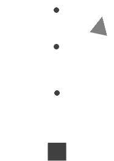

Repository: https://github.com/emedinak/shooter-game.git

Live game: https://emedinak.github.io/shooter-game/index.html

# Shooter Game

A classic shooting game made with HTML, CSS and JavaScript. You control a square at the bottom of the screen, shoot the shapes that fall from the top and dodge their shots.

## How to play

Open `index.html` in a browser. No installation or server is needed.

| Control | Action |
|---|---|
| Left / Right arrows | Move |
| Space bar | Shoot |
| Esc or Q | Pause / resume |
| N | New game |
| Touch screen | Tap to shoot, swipe left or right to move |

1. Shoot the **triangle** and it turns into a star (+1 point).
2. Two seconds later the **final boss** (a pentagon) appears. It moves twice as fast as the triangle and shoots at you.
3. Turn the boss into a star while you still have lives and you win.
4. Every shot that hits you costs one of your **3 lives**. With no lives left, the game is over.

## Class structure

`Entity` is the base class. `Shot` and `Character` extend it, and `Player` and `Opponent` extend `Character`. The new `Boss` extends `Opponent`.

## What was implemented

### Task 1: score
- `Game` has a new `score` attribute that starts at 0.
- `Opponent.collide()` adds one point each time an opponent is turned into a star.

### Task 2: lives
- The initial number of lives is a constant in `main.js` (`PLAYER_LIVES = 3`) and `Player` stores it in its new `lives` attribute.
- `Player.collide()` removes one life. If there are lives left, the player "dies" for two seconds (`super.collide()`) and then revives: `image.src` goes back to `myImage` and `dead` goes back to `false`. With no lives left, the player stays dead and `endGame()` is called.
- `index.html` has a list with `<li id="scoreli">` (`Score: x`) and `<li id="livesli">` (`Lives: y`). `Game.render()` updates both with `innerHTML`, so they are always up to date.

### Task 3: final boss
- `Boss.js` defines `Boss extends Opponent`. It calls `super(game)` and overrides `speed` (twice the opponent's, `BOSS_SPEED` in `main.js`), `myImage` and `myImageDead` (`boss.png` and `boss_dead.png`).
- `Game.removeOpponent()` creates a `Boss` when the triangle is defeated, and ends the game when the boss is defeated.
- `Game.endGame()` keeps its original header. It shows `you_win.png` if the boss was defeated and the player has more than 0 lives, and `game_over.png` otherwise.

## Extras

- **Key hints on the buttons:** `Pause (Esc / Q)` and `NEW GAME (N)`.
- **N key:** starts a new game, the same as the button.
- **Background selector:** a drop-down next to NEW GAME with five light backgrounds (Classic white, Ice, Mint, Peach and Lavender). Classic white is the default. The choice is saved in the browser, so it is kept after pressing NEW GAME. All of them are light on purpose, because every sprite is grey.
- **No double ending:** `endGame()` and `removeOpponent()` do nothing if the game has already ended. For example, if you lose your last life while the boss is dying, you get "game over" and not two final screens.

## Files

| File | Content |
|---|---|
| `index.html` | Page, score and lives list, buttons and background selector |
| `game.css` | Styles, spin animation and backgrounds |
| `main.js` | Constants, helper functions and game start |
| `Game.js`, `Entity.js`, `Character.js`, `Player.js`, `Opponent.js`, `Boss.js`, `Shot.js` | One class per file |
| `assets/` | Game images (unchanged) |
| `tests/` | Automatic checks provided with the assignment |
